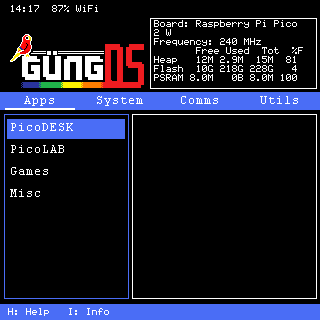

# GungOS

A handheld engineering computer for **PicoCalc with Raspberry Pi Pico 2 W**.
By Cem Gungor, based on [Picoware by jblanked](https://github.com/jblanked/Picoware).



*Simulator preview; resource figures reflect the host.*

GungOS v2.2 combines a dark desktop, a calculator widget, themed menus and
keyboard-driven applications on a 320 × 320 display.

- **PicoDESK:** Eggcel spreadsheets and charts, PicoWord notes/equations, PicoPaint drawing.
- **PicoLAB:** scientific calculator, statistics, solvers, complex/Base-N/matrix modes,
  Graph and Graph3D, backed by a selected float32 ulab build.
- **Games and Misc:** Tetris, a Lorenz screensaver and calculator widget.
- **System and connectivity:** SD file manager, PicoIDE, Wi-Fi, Bluetooth and USB.

The latest Eggcel sources include Range→Go, fill down/right, one-step undo,
formula-to-value conversion, XY/column/pie charts and local error recovery.
The firmware remains v2.2. Further engineering modules are drafts.

## Build and install

This is the **source repository**. Generated UF2/MPY files, SD ZIPs and local
backups are kept outside Git. [BUILD.md](BUILD.md) describes building the firmware
and clean SD package using the included pinned dependencies; normal host tools
and an Arm compiler are required. See [START-HERE.md](START-HERE.md) for the local workflow.

After building:

1. Copy the contents of `sd-card/` to a writable FAT32 SD card.
2. Put the **Pico 2 W** into BOOTSEL mode and copy
   `firmware/GungOS-v2.2-PicoCalc-Pico2W.uf2` onto its bootloader drive.
3. Insert the SD and reboot. Configure Wi-Fi under Comms → Wi-Fi → Scan.

The UF2 targets Pico 2 W; other Pico variants need their own build. Subsequent
app edits normally need only SD `.mpy` replacements. Firmware/native/font changes
need a new UF2. Build outputs belong in GitHub Releases with their matching
source revision, rather than the source history.

## Simulator

Build the host simulator as described in [BUILD.md](BUILD.md), then run:

```sh
sh tools/run-micropython-desktop.sh --viewer --board picocalc-pico2w
```

`Start Simulator.command` is a convenience launcher on macOS. Locally cached
executables are not part of the repository. SDL2 enables the viewer/audio;
headless checks use `--headless --network offline --audio silent`.

## Controls and documentation

Escape returns/cancels. Back and Del erase before the cursor. F6–F10 use
Shift+F1–F5 on PicoCalc. Menus and app chrome follow the system accent.

[Desktop](guides/Desktop.md) · [Eggcel](guides/Eggcel.md) ·
[Calculator](guides/ScientificCalculator.md) · [Graph](guides/Graph.md) ·
[Graph3D](guides/Graph3D.md) · [Audio](guides/TetrisAudio.md) ·
[Connectivity review](guides/Connectivity.md) · [Comms and service independence](guides/Comms.md)

## License and media

The Picoware-derived software is **GPLv3**. Preserve [LICENSE](LICENSE),
[CREDITS.md](CREDITS.md), source notices and [third-party licenses](THIRD_PARTY_NOTICES.md).
Pinned third-party source stays in `vendor/` for offline builds.

The original Game Boy Tetris recordings are **not included in the public source
or default generated packages**. There is no recorded redistribution grant for
those supplied files. Tetris runs without them; optional sound requires your own
licensed assets. See [audio setup](guides/TetrisAudio.md).

[Contributing](CONTRIBUTING.md) · [Public repository checks](verification/public-review.md)
