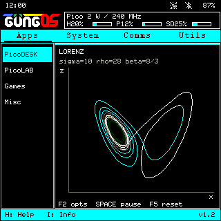

# GungOS

A handheld engineering computer for **PicoCalc with Raspberry Pi Pico 2 W**.
By Cem Gungor, based on [Picoware by jblanked](https://github.com/jblanked/Picoware).



*Simulator preview with the current logo and Lorenz widget; status and resource figures are simulated.*

GungOS v1.33 combines a customizable desktop, a calculator widget, themed menus and
keyboard-driven applications on a 320 × 320 display.

- **PicoDESK:** Eggcel spreadsheets and charts, PicoWord notes/equations, PicoPaint drawing.
- **PicoLAB:** scientific calculator, statistics, solvers, complex/Base-N/matrix modes,
  Graph and Graph3D, direct-geometry PicoCAD, Beam view for beams/plane frames,
  Mohr circles and Shrink Fit, backed by float32 ulab and the picosolve solver.
- **Games and Misc:** Tetris, Lorenz and Lenia screensavers, a calculator widget,
  and an [engineering render stress benchmark](guides/EngToolBenchmark.md).
- **System and connectivity:** SD file manager, PicoIDE, Wi-Fi, Bluetooth and USB.

The latest Eggcel sources include Range→Go, fill down/right, one-step undo,
formula-to-value conversion, XY/column/pie charts and local error recovery.
Firmware and SD application updates ship together as v1.33.
System → Settings → Appearance customizes the accent, canvas and dark/light
surface text colours with a live preview. Further engineering disciplines remain drafts.

Version 1.33 makes the core faster, measured on the device with the new core
benchmark (F6 in the render benchmark): menus draw in 13 ms instead of 35,
alerts in 7 instead of 48, and text formatting is 5× faster. It also fixes SD
directory corruption from the FAT32 driver.
It retains the v1.31 fix that returns closed apps' memory: SD app code unloads at the menus.
It fixes the v1.3 performance issue (heap kept climbing after closing apps);
use v1.33, not v1.3.
Version 1.3 added Beam view (beams, plane frames, section editor), a shared
PicoLAB interface for Beam view, Graph and Graph3D, and Graph3D ranges and heat
maps; the firmware adds plane frames to picosolve. Version 1.2 introduced native graphics, SRAM/PSRAM
image modes, changed-row DMA transfers, cached built-in imports and native
numerical acceleration. See [performance testing](guides/Performance.md) for
the build workflow and on-device benchmark instructions.

## Build and install

This is the **source repository**. Generated UF2/MPY files, SD ZIPs and local
backups are kept outside Git. [BUILD.md](BUILD.md) describes building the firmware
and clean SD package using the included pinned dependencies; normal host tools
and an Arm compiler are required. See [START-HERE.md](START-HERE.md) for the local workflow.

After building:

1. Back up the SD card. For a fresh card, copy `sd-card/` onto writable FAT32.
   For an upgrade, merge the app files while retaining existing settings and documents.
2. Put the **Pico 2 W** into BOOTSEL mode and copy
   `firmware/GungOS-v1.33-PicoCalc-Pico2W.uf2` onto its bootloader drive.
3. Insert the SD and reboot. Configure Wi-Fi under Comms → Wi-Fi → Scan.

This source tree targets only PicoCalc with Pico 2 W. Subsequent
app edits normally need only SD `.mpy` replacements. Firmware/native/font changes
need a new UF2. Build outputs belong in GitHub Releases with their matching
source revision, rather than the source history. Local `releases/` packages
are snapshots and must be rebuilt to include later source changes.

## Simulator

Build the host simulator as described in [BUILD.md](BUILD.md), then run:

```sh
sh tools/run-micropython-desktop.sh --viewer --board picocalc-pico2w
```

`Start Simulator.command` is a convenience launcher on macOS. Locally cached
executables are not part of the repository. SDL2 enables the viewer/audio;
headless checks use `--headless --network offline --audio silent`.

## Controls and documentation

Escape returns/cancels. Back and Del erase before the cursor. F6–F10 use
Shift+F1–F5 on PicoCalc. Alt+S saves a screenshot from any screen. Menus and app chrome follow the system accent.

[Desktop](guides/Desktop.md) · [Screens and controls](guides/UI.md) · [Menu headers](guides/MenuHeaders.md) · [Themes](guides/Themes.md) · [Lorenz](guides/Lorenz.md) · [Lenia](guides/Lenia.md) · [Eggcel](guides/Eggcel.md) ·
[PicoLAB](guides/PicoLAB.md) · [PicoCAD](guides/PicoCAD.md) · [Calculator](guides/ScientificCalculator.md) · [Graph](guides/Graph.md) ·
[Graph3D](guides/Graph3D.md) · [Tetris](guides/Tetris.md) · [Audio](guides/TetrisAudio.md) ·
[Connectivity review](guides/Connectivity.md) · [Comms](guides/Comms.md)

## License and media

The Picoware-derived software is **GPLv3**. Preserve [LICENSE](LICENSE),
[CREDITS.md](CREDITS.md), source notices and [third-party licenses](THIRD_PARTY_NOTICES.md).
Pinned third-party source stays in `vendor/` for offline builds.

The original Game Boy Tetris recordings are **not included in the public source
or default generated packages**. There is no recorded redistribution grant for
those supplied files. Tetris runs without them; optional sound requires your own
licensed assets. See [audio setup](guides/TetrisAudio.md).

[Contributing](CONTRIBUTING.md) · [Public repository checks](verification/public-review.md)
